<p align="center">
  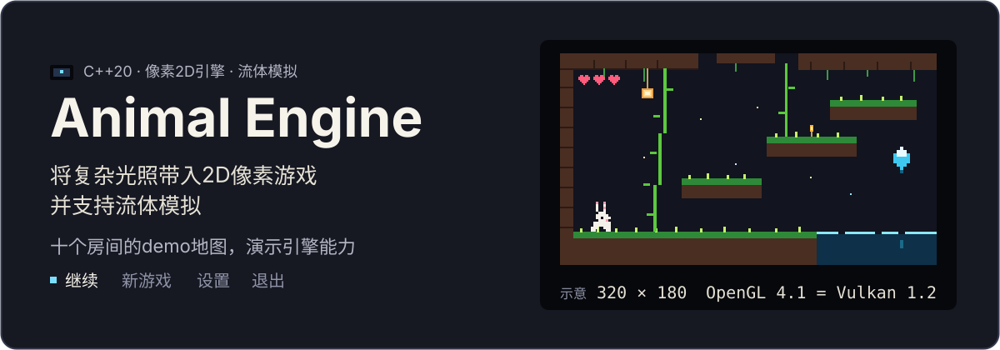
</p>

<p align="center">

  
  
  
  
  
  <a href="LICENSE"></a>
</p>

Animal Engine 是为像素风二维探索游戏准备的 C++20 引擎，并附带一座可以玩通的洞穴。

画布锁在 **320×180**。窗口按整数倍放大，多出来的边缘留黑，像素边界始终清楚。

<p align="center">
  <a href="#画面"><b>画面</b></a>
  &nbsp;&nbsp;·&nbsp;&nbsp;
  <a href="#快速开始"><b>快速开始</b></a>
  &nbsp;&nbsp;·&nbsp;&nbsp;
  <a href="#玩洞穴"><b>玩洞穴</b></a>
  &nbsp;&nbsp;·&nbsp;&nbsp;
  <a href="#做关卡"><b>做关卡</b></a>
  &nbsp;&nbsp;·&nbsp;&nbsp;
  <a href="#开发"><b>开发</b></a>
</p>

## 画面

下面的录像和静帧都是引擎自己画出的 320×180 画布，按最近邻放大，像素边保持硬边。

<p align="center">
  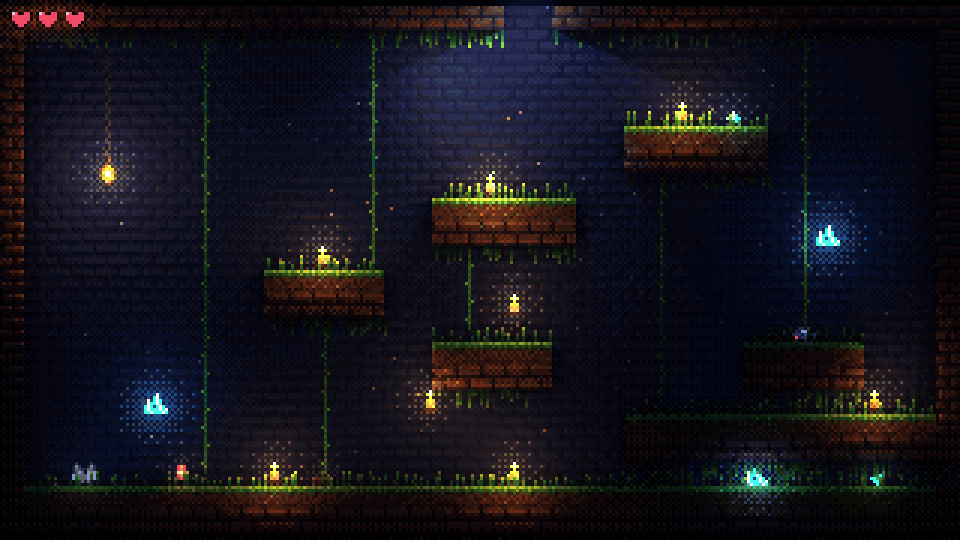<br>
  <sub>七秒演示 · 抓住藤蔓，再跑进水晶长廊</sub>
</p>

<table>
  <tr>
    <td width="50%" align="center">
      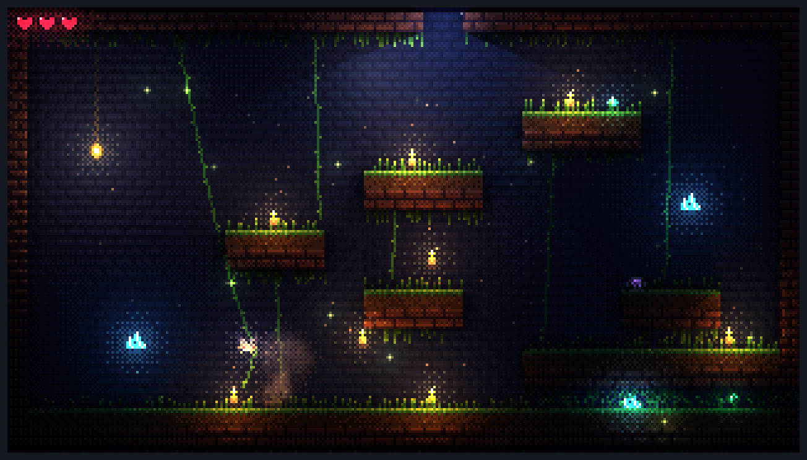<br>
      <sub><b>入口</b> · 藤蔓、吊灯、宝石</sub>
    </td>
    <td width="50%" align="center">
      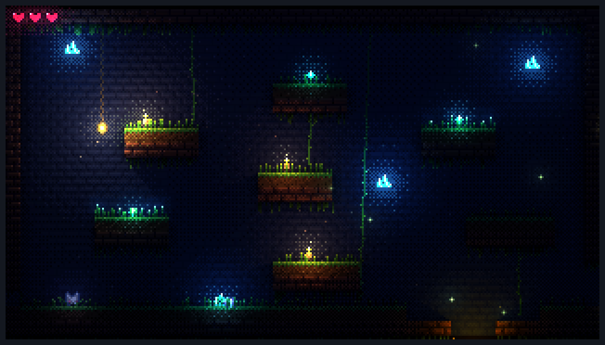<br>
      <sub><b>水晶长廊</b> · 色阶光照与晶体</sub>
    </td>
  </tr>
  <tr>
    <td width="50%" align="center">
      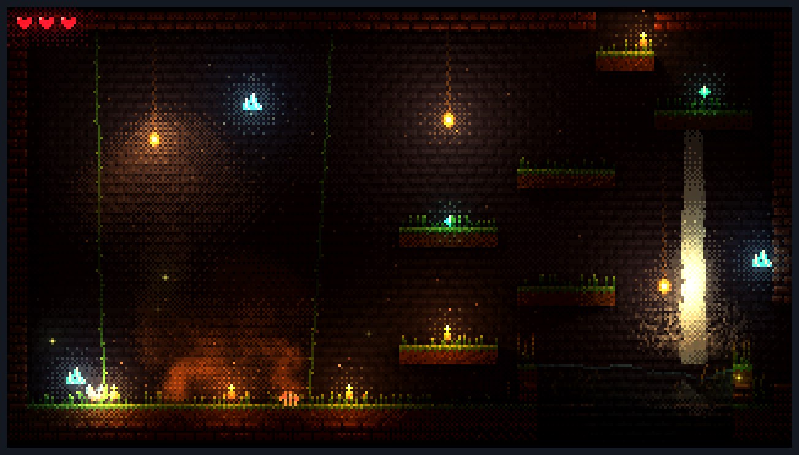<br>
      <sub><b>烟雾深坑</b> · 烟柱、瀑布、余烬</sub>
    </td>
    <td width="50%" align="center">
      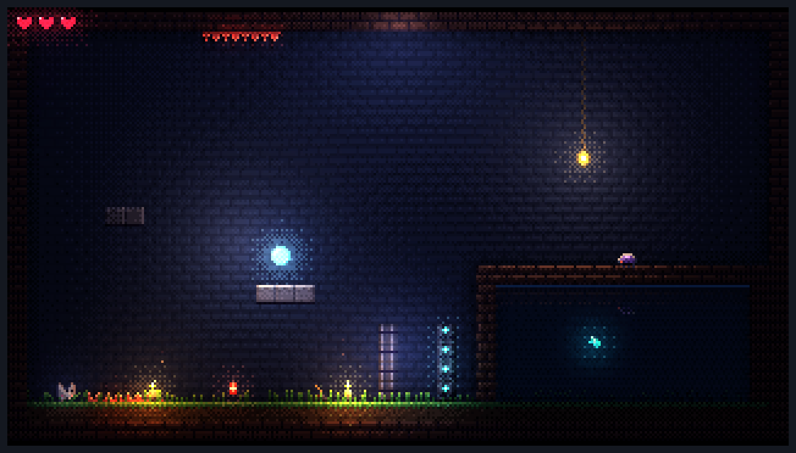<br>
      <sub><b>机关</b> · 水面、平台、闸门</sub>
    </td>
  </tr>
</table>

同一帧，只差光照开关（游戏里的 <kbd>F3</kbd>）。烟在暗处会淡下去，瀑布和水面也不再被光提亮。

<table>
  <tr>
    <td width="50%" align="center">
      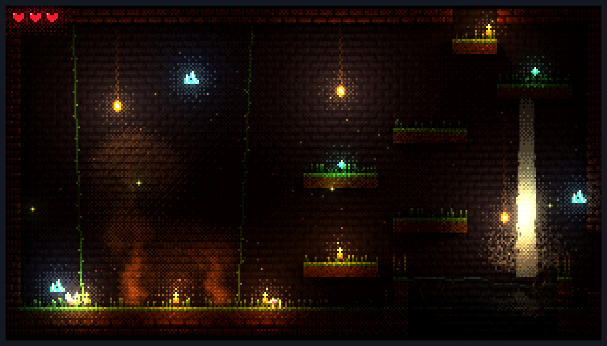<br>
      <sub><b>光照开</b></sub>
    </td>
    <td width="50%" align="center">
      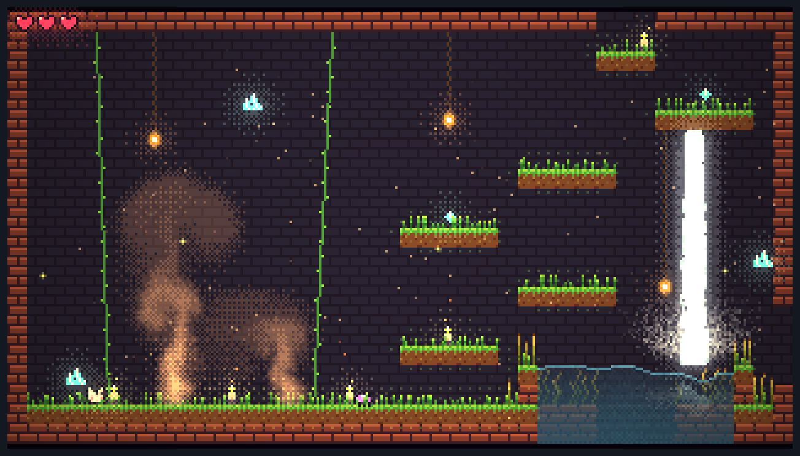<br>
      <sub><b>光照关</b></sub>
    </td>
  </tr>
</table>

光照、烟雾、水面和植被都画在这张小画布上，再合成、泛光、调色。OpenGL 4.1 与 Vulkan 走同一条路径：固定步长、固定输入时，两后端的画面逐像素相同。

<p align="center">
  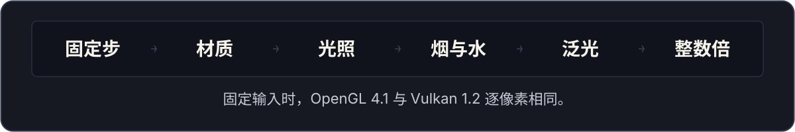
</p>

| | |
|---|---|
| **光照** | 法线、自发光、硬边阴影、边缘光与间接光。每间房间一份观感预设，明暗按色阶量化。 |
| **烟雾与水** | 低分辨率流体烟雾，会被角色、藤蔓、吊灯和爆炸推动。水面有波纹、折射和倒影。 |
| **植被与粒子** | 弹簧草、可攀爬的藤蔓，随风和碰撞摆动。萤火虫、灰尘、火星与瀑布。 |
| **一屏一间** | 用 [Tiled](https://www.mapeditor.org/) 摆房间，走出屏幕就切换。触发器、机关、存档和地图都在关卡数据里。 |
| **改完即见** | 保存贴图、着色器、房间或预设，大约半秒内热重载。文件有错就留下旧版本，并在画面上说明原因。 |
| **可以发行** | 源资源烘焙成一份确定的 `data.pak`。macOS 打成 `.app`，Windows 打成带版本信息的 exe。 |

示例是一座 **10 个房间**的洞穴：宝石、移动平台、尖刺、下潜、炸药，和一扇要宝石才开的闸门。从标题画面可以玩到终点。

## 快速开始

> [!TIP]
> macOS 上日常开发用这两行：`cmake --preset macos-ninja-debug`，然后 `cmake --build --preset macos-ninja-debug`。

| 平台 | 需要 |
|---|---|
| macOS 13.3+ | Xcode（Apple Clang）、CMake ≥ 3.25、Ninja（可选） |
| Windows 10+ x64 | Visual Studio 2022（MSVC）、CMake ≥ 3.25、Ninja（可选） |

第三方库以子模块固定在仓库里（见 [external/README.md](external/README.md)），不用单独安装 SDL 或 Vulkan SDK。

```bash
git clone https://github.com/YINGHAIDADA/AnimalEngine.git
cd AnimalEngine
git submodule update --init --depth 1
```

工程文件由 CMake 生成到 `build/<preset>/`，不要提交，也不要在 IDE 里改工程设置。

```bash
# macOS · 日常开发（Ninja）
cmake --preset macos-ninja-debug
cmake --build --preset macos-ninja-debug

# macOS · Xcode（scheme 选 animal_game）
cmake --preset macos-xcode
open build/macos-xcode/AnimalEngine.xcodeproj

# Windows · Visual Studio 2022（animal_game 已是启动项目）
cmake --preset windows-vs2022
start build\windows-vs2022\AnimalEngine.sln

# Windows · Ninja（在 “x64 Native Tools Command Prompt for VS 2022” 里）
cmake --preset windows-ninja-debug
cmake --build --preset windows-ninja-debug
```

可执行文件在 `build/<preset>/bin/<Config>/AnimalGame`，旁边的 `data/` 是构建时生成的着色器与资源。

```bash
./build/macos-ninja-debug/bin/Debug/AnimalGame
```

## 玩洞穴

启动后是标题画面：继续、新游戏、设置、退出。游戏中按 **Esc** 或 **P**（手柄 Menu）暂停。设置里可以调音量、全屏、垂直同步、帧率上限、亮度与画面效果、语言（简体中文 / 英文），也可以重绑每个动作。F11 或 Alt+Enter 切换全屏，窗口大小和位置会被记住。

| 动作 | 键盘 | 手柄 |
|---|---|---|
| 跑；在藤蔓上荡 | <kbd>←</kbd> <kbd>→</kbd> <kbd>A</kbd> <kbd>D</kbd> | 左摇杆 / 十字键 |
| 抓住藤蔓；上下爬，底端向下松手 | <kbd>↑</kbd> <kbd>W</kbd> <kbd>↓</kbd> <kbd>S</kbd> | 摇杆或十字键的上、下 |
| 跳（按住更高）；从藤蔓上跳离 | <kbd>Space</kbd> <kbd>Z</kbd> | 南键（Xbox A / PlayStation ×） |
| 朝面朝的方向扔炸药 | <kbd>X</kbd> | 西键 |
| 地图 | <kbd>M</kbd> | Back |
| 暂停 | <kbd>Esc</kbd> <kbd>P</kbd> | Menu |

洞里散落着 **19 颗宝石**，右上角计数。闸门要 **14 颗**才开，门后是终点。房间按世界坐标排成三行，走出开口就到隔壁。

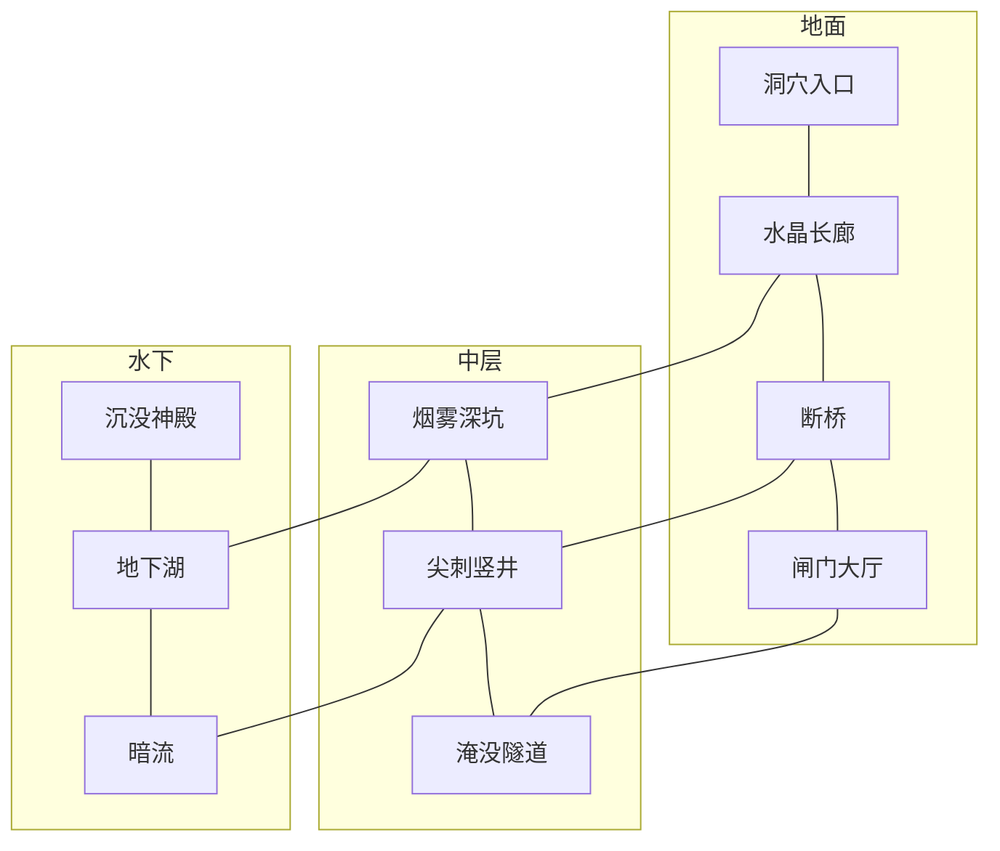

- 断桥上有来回移动的平台，和站上去会塌的平台。掉进深渊是尖刺竖井；井底的宝珠让你在水中按住下潜。
- 学会下潜之后，烟雾深坑的水池下面是一片淹没的区域，水流会推着你走。
- 炸药捡起来就带走（血量下面按个数显示）。扔出后引信闪两秒，然后炸出一团烟，震开附近的吊灯、藤蔓和草，并炸死甲虫。吊灯比角色重，只会轻轻摆开。
- 左上角是 3 颗心，每颗 4 滴。被甲虫撞到会扣 1 滴并弹开；碰到尖刺或被平台挤住也会扣血，并回到这间房里第一次站稳的位置。血掉光时回到检查点并回满。掉出世界不扣血。
- 走进提示区域时，屏幕下方会出现一句说明，用的是你最近拿过的键盘或手柄上的键名。

拾取宝石、按下开关、获得能力、进入新房间后第一次站稳，以及退出时，都会自动保存。下次启动从那里继续。macOS 上的存档在 `~/Library/Application Support/AnimalEngine/Sandbox/`，Windows 上在 `%APPDATA%\AnimalEngine\Sandbox\`。写入前会留一份 `save.json.bak`：存档损坏时用备份恢复，来自更新版本的存档不会被盖掉。`--demo`、`--deterministic` 和 `--start-room` 不读写存档。

> [!NOTE]
> 音效和一部分贴图仍是占位。音效源文件在 `assets/source/sounds/`（WAV 或 Ogg Vorbis），同名替换即可。音量分组在参数表的 `audio.*` 里。

## 做关卡

用 Tiled 打开 `assets/source/world/test.world`，就能看到并编辑全部房间。开发构建里保存源文件即热重载；也可以在游戏中按 **Tab** 打开关卡编辑器，再按一次 Tab 从当前状态继续玩，不必先保存。

编辑器里：**V** 选择和移动，**O** 放置对象，**B** / **R** 画 Tile，右键擦除，Alt+点击取色。Ctrl+Z 撤销，Ctrl+S 保存（macOS 用 Cmd）。保存进 `assets/source/world/rooms/*.tmj`，Tiled 仍能打开。

房间最初由 `tools/scripts/make_test_world.py` 生成。这个脚本现在拒绝覆盖已有文件，`--force` 才会覆盖，并丢掉之后的修改。

<details>
<summary>关卡数据速查</summary>

约定的全文在 ADR 里：[房间与 Tile](docs/ADR/ADR-0010-tiled-levels.md)、[玩法对象与存档](docs/ADR/ADR-0011-gameplay-elements-and-save.md)、[观感](docs/ADR/ADR-0015-looks.md)、[粒子](docs/ADR/ADR-0017-effect-presets.md)、[水](docs/ADR/ADR-0018-water.md)、[植物与风](docs/ADR/ADR-0019-wind-and-plants.md)。

| 放在哪里 | 名称 | 作用 |
|---|---|---|
| Tile 属性 | `solid`、`grass`、`light*`、`hazard`（`up` / `down` / `full`） | 碰撞、长草、发光砖、尖刺 |
| 地图属性 | `look`、`look.*` | 观感预设，以及单项覆盖 |
| 地图属性 | `wind.strength`、`wind.gusts`、`wind.gustInterval`、`wind.gustSpeed` | 微风与阵风 |
| 点对象 | `spawn`、`candle`、`vent`、`vine`、`light`、`lantern`、`gem`、`crawler`、`wind`、`switch`、`ability`、`dynamite`、`entry` | 起点、道具、光源、宝石、甲虫、气流、开关、能力（`name` = `dive`）、炸药、传送落点 |
| 矩形对象 | `trigger`、`water`、`plants`、`emitter`、`platform`、`door`、`goal` | 提示、水域与水流、植物、粒子、移动或坠落平台、门（`flag` 或 `gems`）、终点 |
| 预设 | `looks/*.look.json`、`effects/*.effect.json`、`plants/*.plant.json` | 可复用的观感、粒子（`"gpu": true` 走 GPU）、植物。格式错误会指出文件和字段 |
| 文字 | `assets/source/strings/*.strings.json` | 界面文案。对象的 `message` 写键（如 `level.spikes`）就随语言切换，写原文就照原样显示 |
| 参数 | `world/tuning.json` | 只写下与代码默认值不同的玩家、攀爬、游泳、烟雾参数 |
| 精灵表 | `textures/creature.json` | Aseprite 导出。标签：`idle` `run` `jump` `fall` `climb` `land` |

</details>

## 开发

依赖只能向下：游戏可以用引擎，引擎不知道这是哪一款游戏。图形 API 只出现在 `engine/src/rhi/opengl/` 和 `engine/src/rhi/vulkan/`。

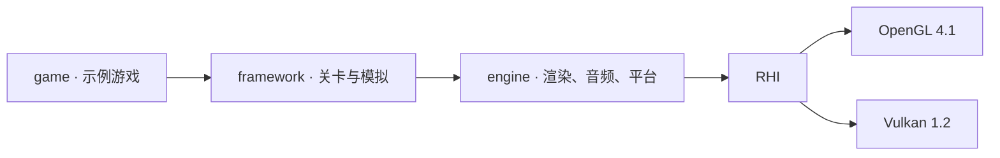

着色器源码在 `shaders/`，关卡和贴图在 `assets/`，编译、烘焙和回归在 `tools/`，架构与决策在 `docs/`。更细的约定见 [docs/ARCHITECTURE.md](docs/ARCHITECTURE.md)。

开发构建默认打开工具（CMake 选项 `ANIMAL_DEV_TOOLS`）。按键盘左上角的 `` ` `` 显示或隐藏。

| 键 | 作用 |
|---|---|
| F1 | 调试覆盖层：帧时间、绘制规模、后端 |
| F2 | 碰撞：实心砖与角色碰撞框，绿色表示着地 |
| F3 | 光照开关。关掉时看到的是原始颜色 |
| F4 | 光照量化：房间观感 / 平滑 / 3 / 5 / 8 级 |
| F5 | 流体烟雾 |
| F6 | 泛光与调色 |
| F7 | 阴影 |
| F8 | 删除存档，从起点重来 |
| F9 | 重新读取观感预设 |
| F10 | 粒子。覆盖层会显示数量和 CPU 耗时 |
| F12 | 截图到 `screenshots/` |
| Tab | 关卡编辑器 |

View 菜单里有性能曲线、渲染开关、房间传送、世界布局、观感 / 效果 / 植物编辑、参数滑条、动画预览和控制台。保存 `assets/source/` 或 `shaders/` 下的文件后，游戏会在大约半秒内载入。着色器绑定变了就重建渲染器；JSON 写错、着色器编不过，则控制台说明原因，屏幕底部显示 `RELOAD FAILED`，游戏继续用上一份。`--deterministic` 和 `--demo` 不监视文件。

日志在用户数据目录的 `logs/Sandbox.log`（保留最近 5 次）。崩溃时在 `crashes/` 写报告：原因、调用栈，以及日志在哪；Windows 另有 minidump。

<details>
<summary>命令行</summary>

| 参数 | 作用 |
|---|---|
| `--backend=opengl\|vulkan` | 图形后端。Vulkan 需要加载器；macOS 开发期用 Vulkan SDK |
| `--no-vsync` | 关闭垂直同步。自动化运行请一直加上 |
| `--hide-overlay` | 隐藏调试覆盖层，用于截图对比 |
| `--deterministic` | 每帧恰好一个固定步，动画和截图可复现 |
| `--demo` | 脚本自己玩一段：爬入口的长藤、荡过去、跳进隧道，再坠入烟雾深坑 |
| `--frames=N` | 渲染 N 帧后退出 |
| `--screenshot=path.png` | 与 `--frames` 合用，保存最后一帧窗口图 |
| `--canvas-screenshot=path.png` | 保存 320×180 最终画布，与窗口大小、DPI 无关 |
| `--profile` | 退出时打印帧时间，以及各渲染 pass 的 GPU 耗时（跳过 60 帧预热） |
| `--stress-lights=N` | 额外加入 N 盏游走的阴影光源 |
| `--start-room=NAME` | 从指定房间开始，例如 `smoke_pit`。不读写存档 |
| `--headless` | 不开窗口。配合 `--demo --deterministic --frames=N` 做自动通关 |
| `--expect=room:NAME,gems:N,…` | 退出时检查结果。未满足则退出码 3 |
| `--strict` | 校验层报错则失败，退出码 4 |
| `--mute` | 不出声。无头运行会自动静音 |
| `--pack=data.pak` | 从资源包读数据。可执行文件旁已有 `data.pak` 时会自动用它 |
| `--data=dir` | 从指定目录读数据。测试用 `test_data`，此时不读写存档 |
| `--input-script=path.txt` | 在指定帧注入按键、鼠标和文本。格式见 `engine/src/app/input_script.h` |
| `--record-input=path.txt` | 把按键录成脚本，退出时写入 |
| `--tools[=窗口,...]` | 启动时打开开发工具。窗口名：`performance` `rendering` `rooms` `look` `effects` `plants` `tuning` `animations` `console` `demo` |
| `--title` / `--menus` | 测试运行也从标题开始，或启用暂停菜单但直接进游戏 |
| `--settings=path` | 使用这份设置文件 |
| `--flags=…` / `--gems=N` | 开局带上这些存档标志，或视为已收集 N 颗宝石 |
| `--trace[=N]` | 每 N 个模拟步打印房间、位置和速度。默认 10 |
| `--resize-test` | 运行中多次改变窗口大小，检查交换链重建 |
| `--crash-test=segv\|abort\|exception` | 故意崩溃，检查崩溃报告。`--crash-dir=` 可改报告目录 |

</details>

<details>
<summary>测试、截图对比与性能</summary>

```bash
ctest --preset macos-ninja-debug
```

Windows 用 `windows-vs2022-debug`、`windows-ninja-debug`；Xcode 用 `macos-xcode-debug`。

推送到 `main` 和每个 PR 时，CI 在 macOS 与 Windows 上构建 Debug、Release，以及关闭开发工具的 Release。警告视为错误。单元测试、无头自动通关（`demo_playthrough`）和崩溃报告测试（`crash_report_*`）一起跑。托管机器没有 GPU，渲染回归在开发机上跑。

测试用独立数据 `tests/data/`，构建后放在 `bin/<Config>/test_data/`。改 `assets/source` 不会影响测试，也不用刷新基准截图。新能力在 `tools/scripts/make_test_data.py` 里加一间测试房，再在 `game/CMakeLists.txt` 里加一条 `animal_add_capability_test`。

```bash
# 7 个固定场景 + RHI 一致性图，两后端必须与 tests/golden/ 逐像素相同
python3 tools/scripts/render_regression.py
python3 tools/scripts/render_regression.py --only demo_pit
python3 tools/scripts/render_regression.py --update   # 有意改画面之后刷新基准

# 同一段演示，OpenGL 与 Vulkan 逐像素对比
B=build/macos-ninja-debug/bin/Debug/AnimalGame
$B --backend=opengl --no-vsync --deterministic --hide-overlay --frames=120 --screenshot=screenshots/gl.png
$B --backend=vulkan --no-vsync --deterministic --hide-overlay --frames=120 --screenshot=screenshots/vk.png
python3 tools/scripts/compare_images.py screenshots/gl.png screenshots/vk.png

# Release 性能。macOS 上分 pass 的数据以 Vulkan 为准
R=build/macos-ninja-release/bin/Release/AnimalGame
$R --backend=vulkan --demo --deterministic --no-vsync --hide-overlay --profile --frames=600
```

</details>

<details>
<summary>发行包</summary>

`*-dist` 预设是 Release，并关闭开发工具和测试。日常的 `*-ninja-release` 仍保留工具；在那种构建里跑 `animal_package` 会直接报错，避免把编辑器打进去。

```bash
cmake --preset macos-dist          # Windows 开发者命令提示符：windows-dist
cmake --build --preset macos-dist  # 编译、烘焙 data.pak、组装并打成 zip
python3 tools/scripts/check_package.py build/macos-dist/package/Release/AnimalEngine-<版本>-macos.zip --forbid "$PWD"
```

macOS 产物是 ad-hoc 签名的 `AnimalEngine.app`，Windows 是带图标和版本信息的 `AnimalGame.exe` 加 `data.pak`。两边都附带 `README.txt`、`THIRD_PARTY_NOTICES.txt` 和列出每个文件大小与 SHA-256 的 `manifest.json`。CI 每次推送都会为两个平台打包，zip 可在 Actions 的构建产物里下载。Developer ID 签名用 `-DANIMAL_CODESIGN_IDENTITY="Developer ID Application: …"`，公证尚未接入。

也可以单独烘焙，不打整包：

```bash
B=build/macos-ninja-release/bin/Release
$B/AnimalCooker --manifest=assets/cook.json --source=assets/source --shaders=$B/data/shaders --out=data.pak --report=report.json
$B/AnimalCooker --verify=data.pak --manifest=assets/cook.json
```

`AnimalCooker` 从世界文件沿着引用收集房间、Tileset、观感、效果、植物，加上代码直接用到的预设、精灵表、材质和着色器。同一份源总是得到逐字节相同的包。旁边的 `cook_report.json` 列出体积、重复内容和没有被引用（因此没打包）的文件。引用缺失或数据无效时烘焙失败。

</details>

## 继续读

| 文档 | 内容 |
|---|---|
| [PROJECT.md](PROJECT.md) | 目标、范围、里程碑和验收标准 |
| [docs/ARCHITECTURE.md](docs/ARCHITECTURE.md) | 模块边界、一帧里发生什么、渲染约定 |
| [docs/ADR/](docs/ADR/) | 关键决策：为什么这样做，以及什么情况下重审 |
| [docs/ART_PIPELINE.md](docs/ART_PIPELINE.md) | 精灵图层、法线图和贴图约定 |
| [docs/KNOWN_ISSUES.md](docs/KNOWN_ISSUES.md) | 已知、尚未处理的问题 |

代码签名、公证，以及在干净机器上的安装验证还留在后续。里程碑和验收记录在 [PROJECT.md](PROJECT.md)，尚未处理的问题在 [docs/KNOWN_ISSUES.md](docs/KNOWN_ISSUES.md)。

## 许可证

Copyright (C) 2026 the Animal Engine authors

Animal Engine 是自由软件：你可以依照自由软件基金会发布的 [GNU 通用公共许可证](LICENSE)第 3 版，或（由你选择）任何更新的版本，再发布和 / 或修改它。发布本程序是希望它有用，但**不提供任何担保**，详见 [LICENSE](LICENSE)。

随项目分发的第三方代码（SDL、zstd、volk、Vulkan Memory Allocator、Vulkan-Headers、nlohmann/json、stb、Khronos 头文件等）与界面字体（Fusion Pixel Font 及其字形来源，SIL OFL 1.1 等）保留各自的许可证，见 [assets/package/THIRD_PARTY_NOTICES.txt](assets/package/THIRD_PARTY_NOTICES.txt)。这些许可证与 GPL-3.0 兼容；字体作为数据随程序分发，仍按其自身许可证使用。
